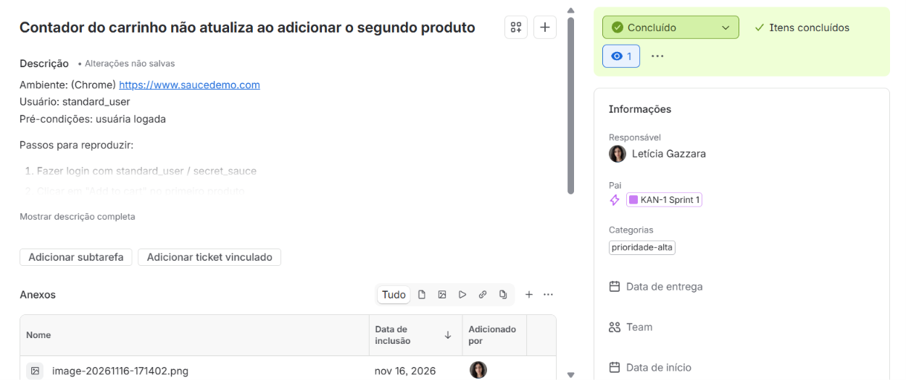
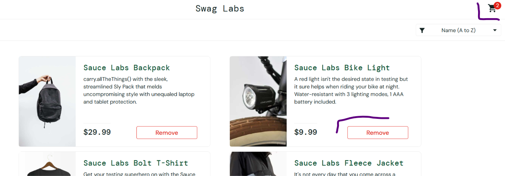

# Documentação de QA

Casos de teste e acompanhamento de um fluxo de login, feitos durante meus estudos.

## Conteúdo
- [casos-de-teste.md](casos-de-teste.md): 5 casos de teste do login do SauceDemo (1 positivo e 4 negativos), executados manualmente
- [bug-report.md](bug-report.md): exemplo de bug report escrito no modelo padrão (bug fictício)

## Acompanhamento no Jira
Projeto Scrum com épico, história, tarefa e bug, movidos pelo quadro durante o estudo.

